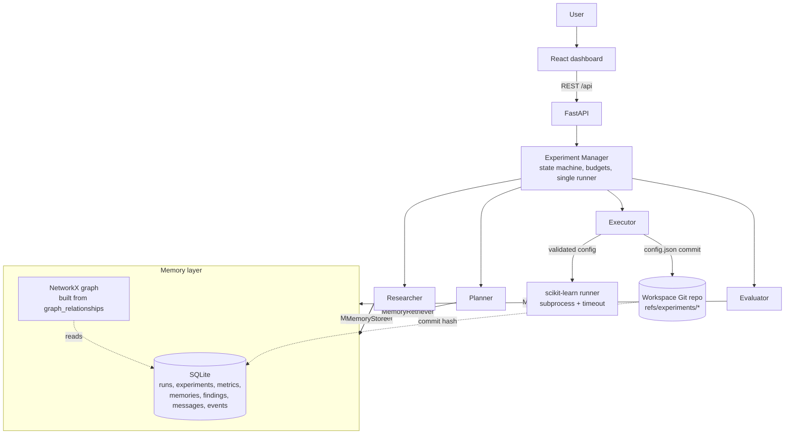

# AI Agent Memory Lab

A local, runnable MVP showing how autonomous agents can **run real ML experiments, keep their full history
(including rejected experiments), share persistent memory, retrieve earlier evidence, and use it to plan
the next experiment**.

> The agents improve their *choices* by reading saved memory. No language-model weights are updated.

Scenario: an engineer starts a run before leaving work. Agents change a model's configuration, train it,
evaluate it and accept or reject the result. Next morning they can see what ran, with which configuration
and Git commit, what was measured, why each decision was made, which earlier experiments influenced later
ones, what was learned, and what is unfinished.

---

## Contents

- [Quick start](#quick-start)
- [Autoresearch mode](#autoresearch-mode)
- [Architecture](#architecture)
- [Technology stack](#technology-stack)
- [Experiment lifecycle](#experiment-lifecycle)
- [Agents](#agents)
- [Memory model and retrieval](#memory-model-and-retrieval)
- [Git versioning](#git-versioning)
- [Knowledge graph](#knowledge-graph)
- [Memory evaluation](#memory-evaluation)
- [API](#api)
- [Configuration](#configuration)
- [Testing](#testing)
- [Known limitations](#known-limitations)
- [Future improvements](#future-improvements)

---

## Quick start

Requirements: Python 3.11+, Node 18+, Git. No GPU, Docker, API key or external service is needed.

```bash
make install            # creates .venv, installs backend + frontend dependencies
make demo-fresh         # resets data/ + workspace/, runs the scripted demo and the memory on/off comparison
make backend            # FastAPI on http://127.0.0.1:8000   (OpenAPI docs: /docs)
make frontend           # dashboard on http://localhost:5173 (proxies /api to the backend)
```

Without `make`:

```bash
python3 -m venv .venv && .venv/bin/pip install -r backend/requirements.txt
(cd frontend && npm install)
.venv/bin/python scripts/demo.py --reset --compare
(cd backend && ../.venv/bin/uvicorn app.main:app --port 8000)
(cd frontend && npm run dev)
```

Optional Docker: `docker compose up --build` (backend :8000, frontend :5173).

The backend applies Alembic migrations, initialises the experiment Git workspace, seeds the agents and
procedural rules, and recovers interrupted runs at startup. To migrate manually: `make migrate`.

### The demo

`scripts/demo.py` runs the full workflow with **real measurements**:

1. initialise the database and the experiment Git workspace;
2. create the initial baseline (Random Forest, 200 trees);
3. run candidate experiments chosen by the Planner;
4. accept or reject each one under the fixed rule;
5. store episodic and semantic memories;
6. answer *"Find rejected experiments that reduced memory use"* from memory, with evidence;
7. let the Researcher turn a rejected experiment's secondary improvement into a hypothesis;
8. run the follow-up experiment and record whether the hypothesis was supported;
9. build the knowledge graph and print an evidence path;
10. print the run summary (and, with `--compare`, the memory on/off evaluation).

If no rejected experiment has a useful secondary result, the demo says so — nothing is fabricated.
`python scripts/demo.py` without `--reset` continues from the existing accepted baseline.

What a fresh demo shows (scores are deterministic for a fixed seed; time and memory vary slightly by machine):
the Random Forest baseline scores a cross-validated F1 of 0.970 ± 0.010. `min_samples_leaf=2` loses 0.003 F1
but gives a 10% smaller model, so it is rejected and kept as a secondary improvement. The Researcher follows it
up by also halving `n_estimators`: peak memory −26% and model size −55%, but F1 still 0.002 below the
baseline. The hypothesis is recorded as *partially supported*, and its memory record becomes `contradicted`.
The Planner then switches to Logistic Regression, which is accepted (0.984). Many of these differences
(0.001–0.003 F1) are smaller than the fold spread (~0.01).

---

## Autoresearch mode

Inspired by [karpathy/autoresearch](https://github.com/karpathy/autoresearch): instead of choosing
hyperparameters, the agent **edits real code** and keeps only what measurably helps.

```bash
make autoresearch                                   # offline idea bank, 20 experiments, 30 minutes
make autoresearch ARGS="--proposer llm --experiments 100 --minutes 480 --tag overnight"
```

Or use the **Autoresearch** page in the dashboard (start/stop, progress chart, `results.tsv`, per-attempt
diffs and logs, best `train.py`, and a `program.md` editor).

| Piece | Role |
|---|---|
| `workspace/autoresearch/train.py` | the **only** file the agent edits; must define `build_model(seed)` returning an estimator |
| fixed harness (`backend/app/autoresearch/harness.py`) | the agent cannot change it: same data, same stratified 5-fold CV, reports `val_f1` |
| `workspace/autoresearch/program.md` | your instructions to the agent (edit them in the dashboard) |
| `workspace/autoresearch/results.tsv` | `commit  val_f1  memory_mb  status  description`, one row per attempt (untracked) |
| branch `autoresearch/<tag>` | each session works on its own branch in the workspace repo |

The loop (as in autoresearch's `program.md`):

1. Run the unchanged `train.py` to get the session baseline.
2. The Autoresearcher agent proposes one focused change and the complete new `train.py`.
3. The change is committed and run by the harness in a subprocess with a time limit (default 120 s).
4. If `val_f1` improved by more than the threshold, the commit is **kept** and the branch advances.
   Equal `val_f1` with fewer lines of code is also kept (the simplicity rule).
5. Otherwise the branch is `git reset --hard` to the last kept commit. The discarded attempt stays reachable
   under `refs/autoresearch/attempts/<experiment_id>`, so its diff can still be inspected.
6. On a crash, the LLM proposer sees the error and gets up to `max_fix_attempts` tries to fix it; ideas that
   still fail are logged as `crash`.
7. Repeat without asking until the experiment count or time budget runs out, or you press Stop.

**Proposers.** With `LAB_LLM_PROVIDER=anthropic` and `ANTHROPIC_API_KEY` set, Claude writes the code. It reads
`program.md`, the current `train.py`, the results history and retrieved memories, and returns the complete new
file (structured JSON output). Without a key, an **offline idea bank** applies built-in code edits: model
swaps, regularisation, class weights, feature selection, interaction features, ensembles, and simplifications.
It runs out of new ideas after about a dozen experiments, while the LLM proposer does not.

**What memory adds beyond autoresearch.** Every attempt is also an experiment record, an episodic memory, a
finding and a set of knowledge-graph relationships in the `autoresearch` namespace. So:
- a **new session starts from the best `train.py` found by earlier sessions**, instead of restarting from
  `master`;
- code that was already tried, in this session or an earlier one, is never re-run;
- the LLM proposer is shown past keeps, discards and crashes.

**Safety.** Running agent-written code goes beyond the original MVP rule ("do not execute agent-generated
Python"), so it is guarded:
- before running, an import allowlist is enforced (numpy, scipy, sklearn and a few standard-library modules),
  with no `sklearn.datasets`, so the agent can't load the labels;
- `open`/`eval`/`exec`/`getattr`/`print`, dunder access and numpy file I/O are blocked;
- the harness runs in a separate process with a time limit, an empty temporary working directory, and an
  environment stripped of secrets, and the score is computed by the harness, not by `train.py`.

This is a guard, **not a security sandbox**: run it only on a machine you control.

---

## Architecture



| Directory | Contents |
|---|---|
| `backend/app/experiments/` | dataset split, search space + validation, runner, metrics, acceptance rules, Git versioning |
| `backend/app/memory/` | `store.py` (writes), `retrieval.py` (reads + ranking), `graph.py` (knowledge graph) |
| `backend/app/agents/` | `base.py` interface, Planner, Executor, Evaluator, Researcher, optional LLM adapter |
| `backend/app/orchestration/` | run state machine, Experiment Manager, recovery/bootstrap, memory evaluation |
| `backend/app/api/` | REST routers |
| `backend/alembic/` | migrations (the schema is never created with `create_all`) |
| `backend/tests/` | unit, integration and end-to-end tests |
| `frontend/src/` | dashboard pages, components, API client, types |
| `scripts/demo.py` | reproducible demo |
| `docs/memory-model.md` | how history, memory types, the Git DAG and the graph differ and fit together |
| `workspace/` | created at runtime: `experiments/` (its own Git repo) and `artifacts/` (not committed anywhere) |
| `data/lab.db` | created at runtime: the SQLite database |

Key decisions:

- **Agents change configurations, never code.** Proposals are `(model_type, configuration)` pairs validated
  against bounded Pydantic schemas before anything runs.
- **Deterministic by default.** Planner, Researcher and Evaluator use documented deterministic policies with a
  seeded RNG. The optional LLM may only *propose* a configuration; acceptance is always rule-based.
- **SQLite is the source of truth.** Git and the knowledge graph are derived, linked records.
- **One active run per process**, plus a database check, so two runs can never race on the baseline pointer.
  A conflicting `POST /api/runs` returns `409`.
- **Namespaces** isolate independent histories (`main` vs. each evaluation trial).

---

## Technology stack

Backend: Python 3.11+, FastAPI, Pydantic v2, SQLAlchemy 2, SQLite (WAL), Alembic, scikit-learn, NumPy,
pandas, psutil, NetworkX, Git (CLI), Pytest. The agent layer is a small custom one (no LangChain, LangGraph
or CrewAI). Frontend: React 18, TypeScript, Vite, Tailwind CSS, React Flow (`@xyflow/react`), Recharts.

---

## Experiment lifecycle

**Dataset and protocol (`eval-v2-cv5`).** Breast Cancer Wisconsin (569 samples), stratified split with a
fixed seed (42): 455 development samples and a 114-sample **held-out test split**. Arrays are read-only.
Decisions use the **mean binary F1 over stratified 5-fold cross-validation** on the development data; the
fold spread is stored as `f1_std`. The test split is evaluated only once per run, on the final accepted
baseline (fit on all development data), after all decisions are made. It is shown for information and never
used for selection.

Protocol versions are never mixed: if the accepted baseline was measured under an older protocol (e.g.
`eval-v1`, a single 114-sample validation split), the next run re-measures that baseline's configuration under
the current protocol before comparing anything, and "already tested" checks only count current-protocol
experiments.

**Models and bounded search space.**

| Model | Parameters (bounds) |
|---|---|
| Logistic Regression (with StandardScaler) | `C` ∈ [1e-4, 1e3], `max_iter` ∈ [100, 5000], `class_weight` ∈ {None, balanced} |
| Random Forest (`n_jobs=1`) | `n_estimators` ∈ [10, 500], `max_depth` ∈ None ∪ [1, 50], `min_samples_leaf` ∈ [1, 50], `max_features` ∈ {sqrt, log2} |

One-step moves: halve or double numeric parameters, scale `C` by √10, toggle categorical values, or switch
model. Every move is re-validated against the bounds.

**Measured per experiment:** accuracy, F1, precision, recall (5-fold means), `f1_std`, `duration_seconds` (all folds), `peak_memory_mb`
(`tracemalloc` peak while fitting and predicting; folds run one at a time, used for comparisons), `process_rss_mb` (psutil, sampled after
training), `model_size_kb` (pickled model), plus seed, dataset version, protocol version and timestamps.
**Duration and memory vary between machines and runs; they are not perfectly reproducible.** Classification
scores are deterministic for a fixed seed.

**Acceptance rule** (`backend/app/experiments/acceptance.py`): accept only if the experiment completed, the
metrics are valid (finite, in range), and cross-validated F1 beats the accepted baseline by **more than**
`LAB_ACCEPTANCE_THRESHOLD` (default 0.001). Ties and sub-threshold gains are rejected. Failed or invalid
results are marked `invalid` and never replace the baseline. Each record stores the baseline id, the primary
delta, every secondary delta and the threshold, along with the decision reason. Lower peak memory or model
size (≥5% relative) or duration (≥25%) on a rejected experiment is preserved as a **secondary improvement**
finding, so it stays searchable.

**Run state machine:** `CREATED → PLANNING → READY → EXECUTING → EVALUATING → STORING_MEMORY → (PLANNING …) →
COMPLETED`, plus `FAILED`, `CANCELLED` and `INTERRUPTED`. Every transition is validated and persisted as a
`run_event`.

**Run controls:** maximum experiments (default 5), maximum run duration (600 s), retries per failed experiment
(1), per-experiment timeout (120 s), stop requests, and a deterministic seed. In `subprocess` mode a timeout
or stop request terminates the training process.

**Recovery:** at startup, runs left in a non-terminal state are marked `INTERRUPTED` and their unfinished
experiments `interrupted`. Completed records and the baseline pointer are untouched, and nothing is re-run
automatically. `POST /api/runs/{id}/resume` starts a new run from the last accepted baseline.

---

## Agents

All agents implement `Agent` (`backend/app/agents/base.py`): a name, role, input/output Pydantic schemas,
declared tools, and `run()`. `run()` validates the input, executes, validates the output and persists an
`agent_action`, including which memories were retrieved and the retrieval latency. Agents reach memory only
through `MemoryStore` and `MemoryRetriever`. Agents communicate with structured, persisted `agent_messages`
(sender, recipient, type, run, experiment, payload, timestamp).

| Agent | Responsibility | Policy |
|---|---|---|
| **Planner** | proposes the next configuration and hypothesis, cites the memories used | *Memory off:* a random (seeded) one-step neighbour of the baseline, with no history consulted. *Memory on:* use an untested Researcher suggestion; otherwise skip already-tested configurations, score each move by the mean measured F1 delta of past experiments that made the same move, and break ties with the seeded RNG. When all neighbours are tested, extend one more step from the best tested neighbour, and stop only when nothing new remains within two steps. |
| **Executor** | validates, commits the config to Git, trains/evaluates with retries and timeout | reports only measured metrics, and cannot touch the data or the rules |
| **Evaluator** | applies the acceptance rule, records deltas, preserves secondary improvements, checks the stated hypothesis | deterministic, never an LLM |
| **Researcher** | searches rejected experiments for verified secondary improvements and proposes a follow-up hypothesis linked to its evidence | keeps the change that saved resources and adds one more move that does not touch the same parameter. Only experiments that lost ≤0.02 F1 qualify, and follow-ups are never chained. The suggestion is stored as **unverified** memory; after it is tested, it becomes `verified` (hypothesis supported) or `contradicted`. |

Optional LLM planning: set `LAB_LLM_PROVIDER=anthropic`, `ANTHROPIC_API_KEY`, and install
`backend/requirements-llm.txt` (default model `claude-opus-5-5`). The LLM receives the baseline, the allowed
search space and retrieved memories, and must return a JSON proposal. Invalid configurations, invented memory
ids, refusals and errors are rejected, and the planner falls back to the deterministic policy, saying so in the
reasoning. Token usage and an estimated cost are recorded in the run summary.

---

## Memory model and retrieval

Every memory record has: id, category, kind, title, content, source run and experiment, creating agent,
timestamps, an evidence payload, a verification status (`verified` | `unverified` | `contradicted`, never an
arbitrary confidence number) and tags.

| Category | Examples (kind) | Written by |
|---|---|---|
| Episodic | `experiment_outcome` (one per experiment, including failures) | Evaluator |
| Semantic | `primary_improvement`, `regression`, `no_primary_effect`, `secondary_improvement`, `failure`, `hypothesis_outcome`, `baseline_established`, `research_suggestion` | Evaluator, Researcher |
| Procedural | `acceptance_rule`, `evaluation_protocol`, `execution_constraints`, `retry_limits`, `allowed_changes` | system (global namespace) |

**Retrieval** (`backend/app/memory/retrieval.py`) first applies hard filters in SQL (category, kind,
decision, status, model type, hyperparameter presence, verification), plus an optional metric goal such as
*peak memory decreased vs. its baseline*. It then ranks the remaining candidates transparently:

```
score = 0.25·text_match + 0.15·model_match + 0.25·config_similarity + 0.25·metric_relevance + 0.10·recency
```

Each component lies in [0, 1]:

- `text_match`: share of query keywords found in the memory text.
- `model_match`: 1 if the model type matches the query.
- `config_similarity`: mean per-parameter similarity, on a log scale for numbers.
- `metric_relevance`: improvement size in the requested direction (|ΔF1|/0.05, or relative change/0.5 for resources).
- `recency`: 1/(1 + age_hours/24).

Every result returns its component breakdown, human-readable reasons, and **evidence copied from stored
measurements** (F1 delta, memory delta, model-size delta, decision, configuration). Memories that reference a
missing experiment, or that have malformed evidence, are skipped and reported. Natural-language queries are
parsed by simple keyword rules (no LLM). The parsed query is returned so you can see how it was interpreted.

See [docs/memory-model.md](docs/memory-model.md) for how experiment history, the three memory types, the Git
DAG and the knowledge graph differ.

---

## Git versioning

The workspace repository `workspace/experiments/` is separate from this project's repository and is
gitignored here. For each experiment the Executor writes `config.json`, which holds the model, configuration,
seed, dataset/protocol versions, hypothesis and parent. It commits that file with `git commit-tree`, **using
the commit of the experiment it was derived from as the parent**, and stores the commit hash on the
experiment. So:

```bash
git -C workspace/experiments log --graph --oneline --all   # experiment derivation DAG
git -C workspace/experiments diff <parent> <child>          # exactly the configuration change
```

Refs live under `refs/experiments/<experiment_id>`. Rejected experiments stay in history. Only small JSON
configs are committed: no data, models, databases or secrets (a workspace `.gitignore` enforces this).
Metrics live in the database, and the accepted baseline is an explicit database pointer (`baseline_pointers`),
never inferred from Git. Commands use argument lists (no shell), and file writes are confined to the
workspace. A missing commit is reported, not fatal.

---

## Knowledge graph

`graph_relationships` rows (source, relation, target, evidence reference, timestamp) are written only after
validating that both endpoints **and** the evidence reference resolve to real records. Invalid relationships
are rejected and logged, never invented. The NetworkX graph is rebuilt from the database on request. A
relationship whose endpoint disappears is reported as *dangling* and left out of the graph.

- **Nodes:** Experiment, Agent, Model, Configuration, Finding, Memory, GitCommit, Run.
- **Relations:** `PROPOSED`, `EXECUTED`, `EVALUATED`, `USES`, `TRAINS`, `PRODUCED`, `SUPPORTED_BY`,
  `DERIVED_FROM`, `RECORDED_IN`, `REFERS_TO`, `INFLUENCED`, `PART_OF`, `COMPARED_AGAINST`.

Queries: experiments in a run, experiments derived from an experiment, findings produced by rejected
experiments, memories that influenced an experiment, and the multi-hop **evidence path** of a finding
(`Finding -SUPPORTED_BY→ Experiment -USES→ Configuration`, plus `RECORDED_IN` commit, `TRAINS` model and
`COMPARED_AGAINST` baseline). Findings describe measured associations on one fixed split, not causation.

---

## Memory evaluation

Research question: *does access to previous experiment records improve an agent's ability to select useful
experiments?* `POST /api/evaluation/compare` (or `make demo-fresh`) runs both planner conditions for each seed.
Every trial starts from an **empty, isolated namespace**, with the same dataset, initial configuration, search
space, budget and acceptance rule. Neither condition can read the other's records, and the main lab is
untouched.

Tracked per trial: best validation F1, experiments, accepted experiments, repeated configurations, prior
findings reused, total experiment time, retrieval count and mean retrieval latency (plus held-out test F1 of
the final baseline, shown for information only, and LLM usage when enabled).

One measured result (protocol `eval-v2-cv5`; seeds 0, 1, 2; budget 6; Random Forest start): memory on reached
a mean best cross-validated F1 **0.009 higher** than memory off, repeated **1.33 fewer** configurations per
trial, and cited 5 prior memories per trial. Without memory, the planner spent budget re-running
configurations it had already tried. This is a **demonstration on one small dataset with three seeds, not a
statistically conclusive study**; run it yourself and read the per-trial table. If memory performs worse in your run, the dashboard shows that.

---

## API

Interactive docs: `http://127.0.0.1:8000/docs`. Collections are paginated (`limit`, `offset`); errors use
`{"error": {"code", "message", "details"}}` with appropriate status codes (404, 409, 422, 503, 500).

| Method | Path | Purpose |
|---|---|---|
| GET | `/api/health` | health, busy flag, execution mode |
| GET | `/api/overview` | dashboard totals and the F1 series |
| POST | `/api/runs` | create and start a run (409 if one is active) |
| GET | `/api/runs` · `/api/runs/{id}` · `/api/runs/{id}/messages` | runs, events, experiments, agent messages |
| POST | `/api/runs/{id}/stop` · `/api/runs/{id}/resume` | graceful stop · new run from the last baseline |
| GET | `/api/experiments` · `/{id}` · `/{id}/history` · `/{id}/metrics` | history, baseline comparison, lineage, Git log/diff, metrics |
| GET | `/api/memory` · `/api/memory/{id}` · `/api/memory/{id}/evidence` | records and resolved evidence |
| POST | `/api/memory/search` | `{"query": "..."}` or `{"filters": {...}}` |
| GET | `/api/agents` · `/api/agents/{id}/activity` | agents, their actions and messages |
| GET | `/api/graph` · `/api/graph/experiments/{id}` · `/api/graph/findings/{id}/evidence` | graph views and evidence paths |
| GET | `/api/graph/runs/{id}/experiments` · `/api/graph/experiments/{id}/derived` · `/api/graph/queries/rejected-findings` | graph queries |
| POST | `/api/evaluation/compare` | memory on/off comparison (background) |
| GET | `/api/evaluation/results` · `/api/evaluation/results/{id}` | comparison results |

Example:

```bash
curl -X POST localhost:8000/api/runs -H 'Content-Type: application/json' -d '{"max_experiments": 5, "memory_enabled": true}'
curl -X POST localhost:8000/api/memory/search -H 'Content-Type: application/json' \
     -d '{"query": "Find rejected experiments that reduced memory use"}'
```

### Dashboard

All five pages read live data from the API:

- **Overview:** totals, F1 chart, start/stop a run, current baseline, latest run summary.
- **Experiments:** filterable table, plus a detail view with the baseline comparison, hypothesis, cited
  memories, Git log and diff.
- **Shared memory:** category filter, search with example queries, ranking breakdown, evidence inspection.
- **Knowledge graph:** React Flow with zoom/pan, node and edge selection, relation labels, legend/type
  toggles, finding evidence paths. Defaults to the latest run to limit clutter.
- **Agents & evaluation:** agent actions, retrieved memories, messages, run lifecycle, memory on/off
  comparison charts.

---

## Configuration

Copy `.env.example` to `.env`. Variables use the `LAB_` prefix: `LAB_DATABASE_URL`, `LAB_WORKSPACE_DIR`,
`LAB_RANDOM_SEED`, `LAB_ACCEPTANCE_THRESHOLD`, `LAB_MAX_EXPERIMENTS`, `LAB_MAX_RUN_SECONDS`,
`LAB_MAX_RETRIES`, `LAB_EXPERIMENT_TIMEOUT_SECONDS`, `LAB_EXECUTION_MODE` (`subprocess` | `inprocess`),
`LAB_LLM_PROVIDER`, `LAB_LLM_MODEL`, `ANTHROPIC_API_KEY`, `LAB_LOG_LEVEL`, `LAB_LOG_JSON`. Secrets are read
from the environment and never returned by the API.

Logs are structured JSON with `run_id`, `experiment_id`, `agent_id`, `event_type` and a timestamp. Lifecycle
events are also persisted in `run_events`.

---

## Testing

```bash
make test        # backend: 77 tests (unit, integration, end-to-end, autoresearch), ~3 min
make build       # frontend: type-check + production build
```

Tests use a temporary SQLite database and a temporary Git workspace per test, and never touch `data/`,
`workspace/` or this repository. They cover:

- config validation, metrics, acceptance (including ties), ranking, graph construction, message validation
  and state transitions;
- integration through the HTTP API, and the full research workflow end to end;
- the edge cases: training crash, invalid metrics, equal scores, a rejected experiment that saves memory,
  no relevant memory, a memory referencing a missing experiment, invalid hyperparameters, the run limit,
  restart after an interrupted run, and dangling graph evidence.

---

## Known limitations

- One small dataset. Even with 5-fold CV, many candidate differences (0.001–0.002 F1) are smaller than the fold
  spread (~0.01); the acceptance threshold (0.001) does not account for that noise.
- The Researcher only acts on memory or model-size savings; duration savings are recorded but considered too
  noisy to steer research.
- Resource metrics are machine-dependent. `peak_memory_mb` tracks Python/NumPy allocations, not native or
  OS-level memory.
- `inprocess` mode cannot interrupt a running training step: a timeout is only detected afterwards.
  `subprocess` mode (default) enforces it, at about 1 s of process start-up per experiment.
- Cross-validation makes each experiment ~5× slower (about 4 s for a 200-tree Random Forest).
- The deterministic planner explores at most two steps from the baseline, and its "move evidence" is a simple
  average.
- Natural-language search is keyword-based, with no embeddings.
- Single process, single active run: no multi-user isolation or authentication (local MVP).
- The memory evaluation uses few seeds and no statistical tests.
- The frontend bundle is unsplit (~800 kB).
- Autoresearch: the code guard is a static allowlist, not a sandbox; the offline idea bank is small; the
  time limit makes slow-but-better models lose by timeout, and timings differ between machines.
- If something else (e.g. the Docker container) already listens on port 8000, `localhost` may reach it
  instead of the local backend; stop one of them.

## Future improvements

Additional datasets and model families; a noise-aware acceptance rule (e.g. require a gain larger than the fold
spread, or a paired test across folds); multi-objective acceptance
(Pareto front over F1 and memory); embedding-based retrieval if keyword retrieval proves insufficient; richer
planner policies (Bayesian optimisation over memory); parallel experiment workers with a proper queue;
authentication; memory consolidation (merging repeated findings) and expiry; more evaluation seeds with
significance testing.

---

## License

[MIT](LICENSE) © 2026 Sherin Dehghani

## Production & scaling

- **Database**: SQLite is the zero-config default. For multi-user or production deployments set
  `LAB_DATABASE_URL=postgresql+psycopg://…`; the engine then uses a connection pool
  (`LAB_DB_POOL_SIZE`, `LAB_DB_MAX_OVERFLOW`, `LAB_DB_POOL_TIMEOUT_SECONDS`, `LAB_DB_POOL_RECYCLE_SECONDS`)
  with pre-ping health checks. `docker compose up` (`make up`) runs the stack on PostgreSQL 16.
- **Health probes**: `/api/health/live` (liveness) and `/api/health/ready` (readiness, checks the DB) for
  Kubernetes / load balancers; `/api/health` keeps the detailed status.
- **Observability**: every response carries `X-Request-ID` (propagated if the client sends one) and
  `X-Process-Time-Ms`; each request is logged as structured JSON.
- **Container**: non-root user, Docker `HEALTHCHECK`, GZip compression for large responses.
- **Concurrency note**: run orchestration uses an in-process lock, so run one API process per workspace;
  scale reads horizontally behind a shared PostgreSQL only once run scheduling moves to a queue.
- **CI**: GitHub Actions runs lint, backend tests, frontend build and the Docker build on every PR.
- **Dev tooling**: `make lint`, `make test`, `make up` / `make down`.
